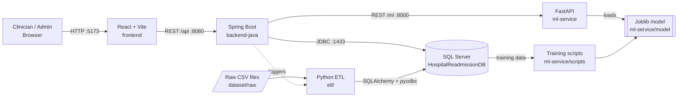
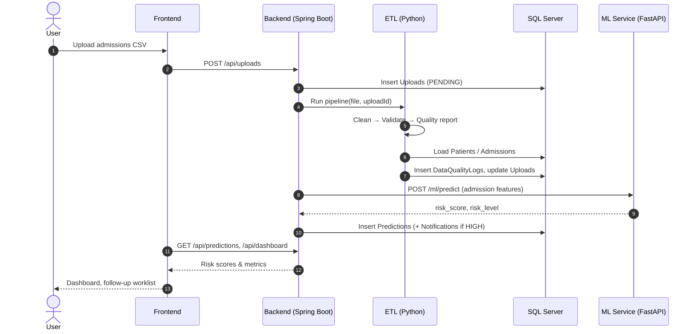

# Hospital-Readmission-AI

**Automated Hospital Data Processing and AI-Based Hospital Readmission Risk Prediction System**

> An AI-powered hospital readmission risk prediction platform with automated ETL, data quality monitoring, machine learning and healthcare analytics.

 

> ⚠️ **Project status:** this repository currently contains the **foundation scaffold only** — folder structure, configuration, health checks and documentation. Business logic, model training and full UI are being built by the team on separate branches.

---

## Table of Contents
1. [Project Description](#project-description)
2. [Problem Statement](#problem-statement)
3. [Proposed Solution](#proposed-solution)
4. [Objectives](#objectives)
5. [Planned Features](#planned-features)
6. [Technology Stack](#technology-stack)
7. [Architecture](#architecture)
8. [Data Flow](#data-flow)
9. [Folder Structure](#folder-structure)
10. [Team Responsibilities](#team-responsibilities)
11. [Installation](#installation)
12. [Service Ports](#service-ports)
13. [Future Scope](#future-scope)
14. [Limitations](#limitations)
15. [Medical Disclaimer](#medical-disclaimer)

---

## Project Description
Hospital-Readmission-AI is a full-stack platform that ingests raw hospital admission data, cleans and validates it automatically, stores it in Microsoft SQL Server, and uses a machine-learning model to estimate each patient's risk of being readmitted within 30 days of discharge. Clinicians and administrators use a web dashboard to review risk scores, monitor data quality, schedule follow-ups and generate reports.

## Problem Statement
Unplanned 30-day readmissions are costly for hospitals and harmful for patients. Many readmissions are preventable with timely follow-up, but:
- Hospital data arrives in inconsistent formats with missing, duplicate and invalid values.
- Data cleaning is manual, slow and error-prone.
- Care teams lack an early, data-driven signal to prioritise which discharged patients need attention.
- Data quality problems are rarely measured, so downstream analytics cannot be trusted.

## Proposed Solution
1. **Automated ETL** — Python pipeline that cleans, validates and loads uploaded files into SQL Server.
2. **Data quality monitoring** — every upload produces a quality report stored in `DataQualityLogs` and shown in the UI.
3. **ML risk prediction** — a scikit-learn model served via FastAPI returns a readmission probability and risk band (LOW / MEDIUM / HIGH).
4. **Clinical workflow** — Spring Boot API and React dashboard to review predictions, assign follow-ups and track outcomes.
5. **Analytics & reporting** — dashboards and exportable reports on risk distribution and data quality.

## Objectives
- Reduce manual data-preparation effort through automated, repeatable ETL.
- Make data quality visible and measurable for every upload.
- Provide an interpretable readmission risk score for each discharge.
- Help care teams prioritise follow-ups for high-risk patients.
- Deliver a modular architecture that four developers can build in parallel.

## Planned Features
| Area | Feature |
|---|---|
| Authentication | Role-based login (Admin, Doctor, Nurse, Analyst) |
| Uploads | CSV upload, processing status, row counts |
| ETL | Cleaning, validation, deduplication, loading |
| Data quality | Missing-value, range, date-logic and duplicate checks with severity |
| Predictions | 30-day readmission probability, risk band, top contributing factors |
| Patients | Search, patient history, admissions timeline |
| Follow-ups | Schedule, assign and complete follow-up actions |
| Notifications | Alerts for high-risk patients and due follow-ups |
| Dashboard | KPIs and charts (Recharts) |
| Reports | Exportable summaries |

## Technology Stack
| Layer | Technologies |
|---|---|
| Frontend | React 18, Vite, TypeScript, Tailwind CSS v4, React Router, Axios, Recharts, Lucide React |
| Backend | Java 17, Spring Boot 3, Maven, Spring Web, Spring Data JPA, Spring Security, Validation, SQL Server JDBC |
| Database | Microsoft SQL Server |
| ETL | Python 3.11+, Pandas, NumPy, SQLAlchemy, PyODBC |
| Machine Learning | Python, scikit-learn, Joblib |
| ML API | FastAPI, Uvicorn, Pydantic |

## Architecture


**Key rule:** the frontend only talks to the backend. The backend is the single gateway to the database and the ML service.

## Data Flow


## Folder Structure
```
Hospital-Readmission-AI/
├── frontend/          # React + Vite + TS UI                 (Member 1)
├── backend-java/      # Spring Boot REST API                 (Member 2)
├── ml-service/        # FastAPI + scikit-learn               (Member 3)
├── etl/               # Python cleaning/validation/loading   (Member 4)
├── database/          # SQL Server schema, views, procs      (Member 4)
├── dataset/           # raw/ processed/ sample/ (raw ignored)(Member 4)
├── docs/              # Architecture, API, workflow docs     (Shared)
├── screenshots/       # UI screenshots for demo/README       (Shared)
├── .github/           # PR + issue templates                 (Shared)
├── .env.example       # Shared environment template
├── CONTRIBUTING.md
├── LICENSE
└── README.md
```
Each service folder has its own `README.md` with details.

## Team Responsibilities
| Member | Branch | Owns | Responsibilities |
|---|---|---|---|
| Member 1 | `frontend` | `frontend/` | UI pages, routing, components, API integration, charts |
| Member 2 | `backend-java` | `backend-java/` | REST API, JPA entities, security, ML service integration |
| Member 3 | `ml-service` | `ml-service/` | Preprocessing, training, evaluation, prediction API |
| Member 4 | `etl-database` | `etl/`, `database/`, `dataset/` | ETL pipeline, data quality, SQL schema, data dictionary |
| All | via PR to `main` | `docs/`, `README.md`, `.github/` | Shared documentation and repo config |

See [docs/team_workflow.md](docs/team_workflow.md) for the branching and PR process.

## Installation
Full guide: [docs/installation_guide.md](docs/installation_guide.md).

**Prerequisites:** Node.js 20+, Java 17+, Maven 3.9+, Python 3.11+, SQL Server 2019+ (or Docker image), ODBC Driver 18 for SQL Server.

```bash
git clone <your-repo-url> Hospital-Readmission-AI
cd Hospital-Readmission-AI
cp .env.example .env            # fill in DB credentials

# 1. Database
sqlcmd -S localhost -U <user> -P <password> -i database/schema.sql
sqlcmd -S localhost -U <user> -P <password> -i database/indexes.sql
sqlcmd -S localhost -U <user> -P <password> -i database/views.sql
sqlcmd -S localhost -U <user> -P <password> -i database/stored_procedures.sql

# 2. ML service  (http://localhost:8000/ml/health)
cd ml-service && python -m venv .venv && source .venv/bin/activate
pip install -r requirements.txt && cp .env.example .env
uvicorn app.main:app --reload --port 8000

# 3. Backend  (http://localhost:8080/api/health)
cd backend-java
cp src/main/resources/application.properties.example src/main/resources/application.properties
mvn spring-boot:run

# 4. Frontend (http://localhost:5173)
cd frontend && cp .env.example .env && npm install && npm run dev

# 5. ETL
cd etl && python -m venv .venv && source .venv/bin/activate
pip install -r requirements.txt
python pipeline.py --input ../dataset/sample/sample_admissions.csv --dry-run
```
On Windows use `.venv\Scripts\activate` and `copy` instead of `cp`.

## Service Ports
| Service | URL | Health check |
|---|---|---|
| Frontend (Vite) | http://localhost:5173 | header status dot |
| Backend (Spring Boot) | http://localhost:8080/api | `GET /api/health` |
| Backend → ML check | http://localhost:8080/api/health/ml | `GET /api/health/ml` |
| ML service (FastAPI) | http://localhost:8000 | `GET /ml/health`, docs at `/docs` |
| SQL Server | localhost:1433 | `python etl/pipeline.py --check-db` |

## Future Scope
- Explainability (SHAP) for per-patient risk factors.
- Scheduled/automatic retraining and model registry.
- HL7 FHIR integration with hospital EHR systems.
- Docker Compose / Kubernetes deployment and CI/CD.
- SMS / email notifications for follow-ups.
- Fairness and bias auditing across demographic groups.
- Multi-hospital / multi-tenant support.

## Limitations
- Scaffold stage: endpoints other than health checks are placeholders.
- Initial database schema is a draft and will change after dataset inspection.
- Model quality depends entirely on the dataset used; public datasets may not generalise to a specific hospital.
- Security is permissive in the scaffold (all requests allowed) and **must** be hardened before use with real data.
- Not validated clinically or certified as a medical device.

## Medical Disclaimer
This software is a **hackathon / educational project**. It is **not** a medical device and has **not** been clinically validated. Predictions must **not** be used to make diagnosis or treatment decisions. Always rely on qualified healthcare professionals. Do **not** upload real, identifiable patient data to this system; use de-identified or synthetic data only, and comply with applicable privacy laws (e.g. HIPAA, GDPR, India's DPDP Act).

## License
[MIT](LICENSE)
