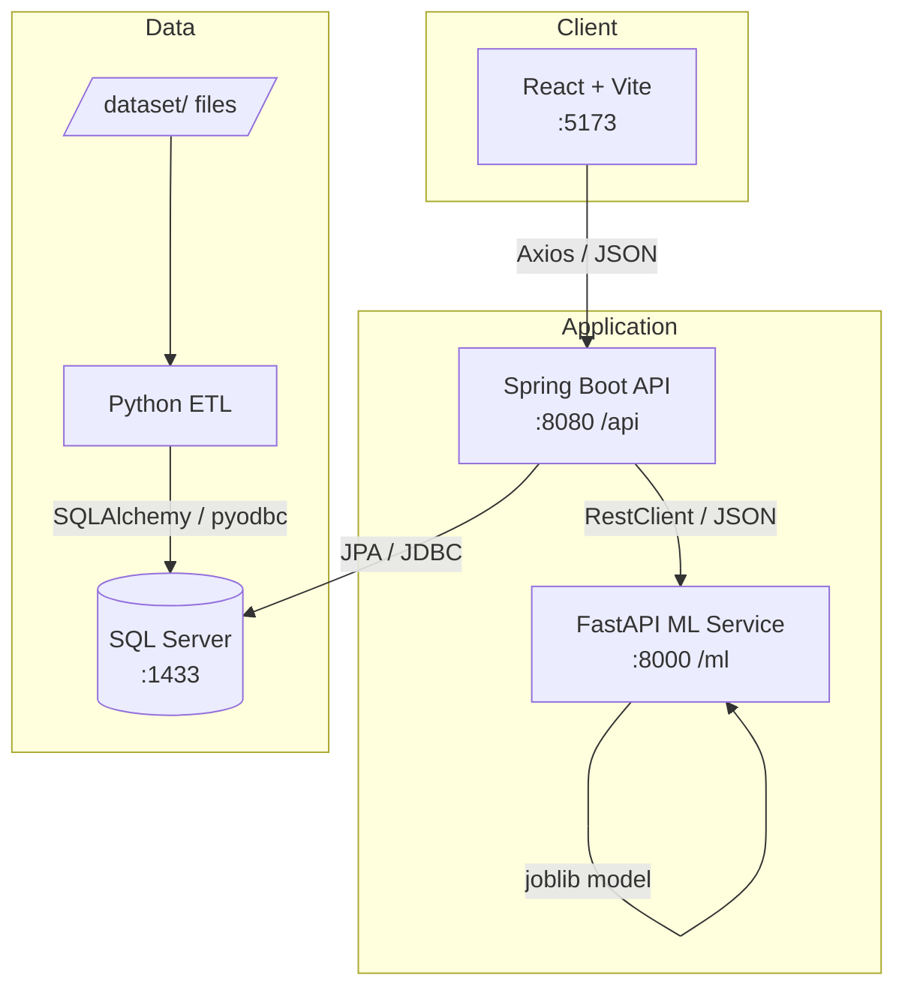

# System Architecture

## Overview
Hospital-Readmission-AI is split into five independently developed components that communicate over HTTP and a shared SQL Server database.

## Components
| Component | Responsibility | Talks to |
|---|---|---|
| **frontend** | UI, routing, charts, user input | backend only |
| **backend-java** | API gateway, auth, business rules, persistence, orchestration | DB, ML service, (ETL trigger) |
| **ml-service** | Feature preprocessing, model inference, training scripts | nothing outbound (stateless); reads model file |
| **etl** | Clean / validate / load raw files; write quality logs | DB |
| **database** | System of record | — |

## Design principles
1. **Single gateway** — the browser only reaches the backend; DB and ML are never exposed to the client.
2. **Schema ownership** — `database/schema.sql` is the source of truth; Hibernate runs with `ddl-auto=none`.
3. **Config via environment** — no credentials in code; every service reads `.env` / env vars.
4. **Stateless ML** — the ML service receives features and returns a score; persistence happens in the backend.
5. **Independent deployability** — each service builds and runs on its own.

## Service communication
| From → To | Protocol | Base URL (dev) | Config key |
|---|---|---|---|
| Frontend → Backend | HTTP/JSON | `http://localhost:8080/api` | `VITE_API_BASE_URL` |
| Backend → ML | HTTP/JSON | `http://localhost:8000` | `ML_SERVICE_URL` → `app.ml-service.url` |
| Backend → DB | JDBC (mssql-jdbc) | `jdbc:sqlserver://localhost:1433;databaseName=HospitalReadmissionDB` | `DB_*` |
| ETL → DB | ODBC via SQLAlchemy | `mssql+pyodbc://...` | `DB_*` |

CORS: backend allows `FRONTEND_URL` (default `http://localhost:5173`); ML service allows `ALLOWED_ORIGINS`.

## ETL invocation options (decision pending)
| Option | Pros | Cons |
|---|---|---|
| A. Backend runs `python etl/pipeline.py` via `ProcessBuilder` | Simple | Needs Python on backend host |
| B. Wrap ETL in a small FastAPI endpoint | Clean HTTP boundary | Extra service |
| C. Manual/scheduled CLI run | Easiest for hackathon | No real-time status |

Team to decide; default for the demo is **C**, upgrading to **A** if time permits.

## Security (planned)
- JWT bearer tokens issued by the backend; roles ADMIN / DOCTOR / NURSE / ANALYST.
- BCrypt password hashing.
- Scaffold currently **permits all requests** — must be locked down before using real data.
