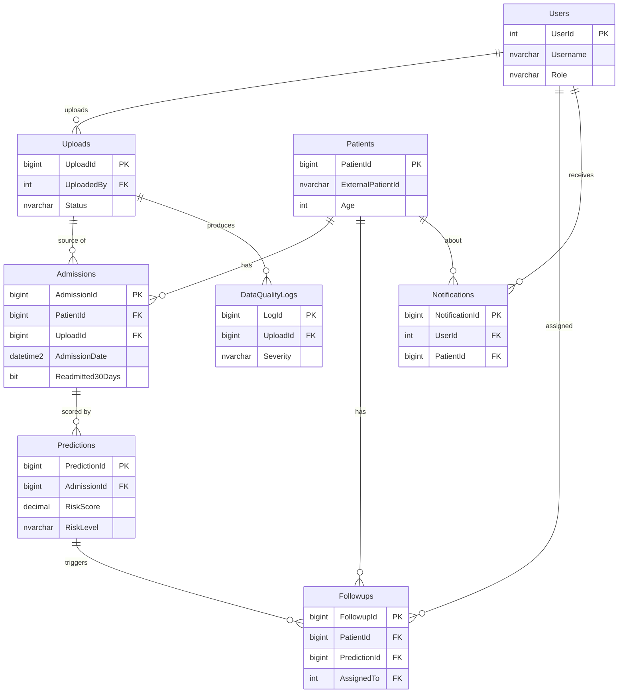

# Database Design

> Initial design — will be refined after dataset inspection. Source of truth: `database/schema.sql`.

## ER diagram

## Conventions
- Schema `dbo`, PascalCase names, singular PK `<Table>Id` (table names plural).
- Named constraints: `PK_`, `FK_<Child>_<Parent>`, `CK_`, `DF_`, `UQ_`, `IX_`.
- Timestamps `DATETIME2` in **UTC** (`SYSUTCDATETIME()`).
- Enumerations enforced with `CHECK` constraints.

## Privacy
- Store pseudonymised `ExternalPatientId`, never names, phone numbers or national IDs.
- Prefer `Age` over `DateOfBirth`.

## Open questions (resolve after dataset inspection)
- Which diagnosis coding system (ICD-9 / ICD-10)? Separate `Diagnoses` table?
- Separate `Medications` / `LabResults` tables vs aggregated counts?
- Store engineered features in a `ModelFeatures` table for reproducibility?
