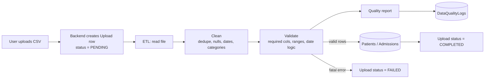
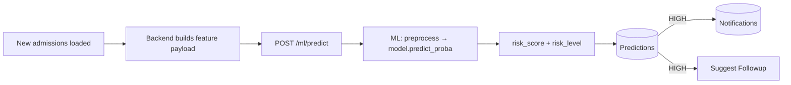

# System Workflow

## 1. Upload & ETL

## 2. Prediction

## 3. Clinical follow-up
1. Doctor/Nurse opens **Predictions**, filters HIGH risk.
2. Creates a **Follow-up** (call, visit, medication review) and assigns it.
3. Assignee completes it; status → COMPLETED.
4. **Reports** show follow-up completion rate and outcomes.

## 4. Model lifecycle
1. ETL produces `dataset/processed/training.csv`.
2. `python -m scripts.train --data ...` trains and saves `model/readmission_model.joblib`.
3. Evaluation metrics recorded in `docs/` or a report.
4. Restart ML service (or reload) — `/ml/health` shows `model_loaded: true`.

## Status values
| Entity | Values |
|---|---|
| Uploads.Status | PENDING → PROCESSING → COMPLETED / FAILED |
| Predictions.RiskLevel | LOW (< 0.3) · MEDIUM (0.3–0.6) · HIGH (≥ 0.6) — placeholder thresholds |
| Followups.Status | SCHEDULED → COMPLETED / MISSED / CANCELLED |
