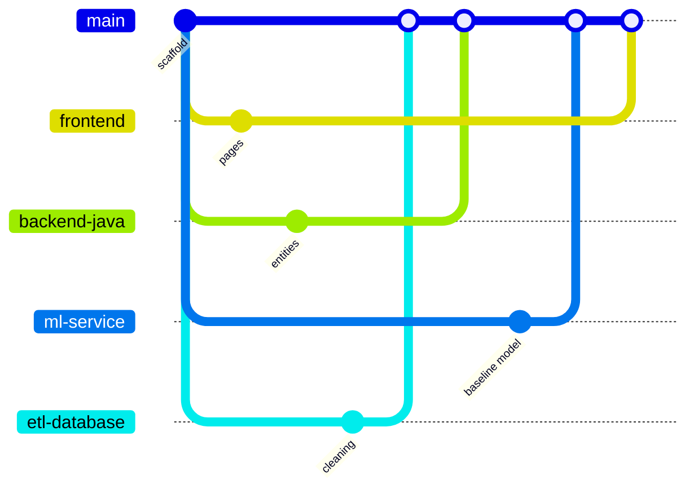

# Team Workflow

## Ownership
| Member | Branch | Owns | Must coordinate with |
|---|---|---|---|
| **Member 1** | `frontend` | `frontend/` | Member 2 (API contracts) |
| **Member 2** | `backend-java` | `backend-java/` | Member 1 (DTOs), Member 3 (ML contract), Member 4 (schema) |
| **Member 3** | `ml-service` | `ml-service/` | Member 2 (predict contract), Member 4 (training data) |
| **Member 4** | `etl-database` | `etl/`, `database/`, `dataset/` | Member 2 (entities), Member 3 (features) |
| **Shared** | PR to `main` | `docs/`, `README.md`, `.github/`, root config | everyone reviews |

**Rule:** only edit files inside your owned folder on your branch. To change someone else's folder, open an issue or ask them — or make a small PR they review.

## Branch model


## One-time setup (each member)
```bash
git clone <repo-url> Hospital-Readmission-AI
cd Hospital-Readmission-AI
git fetch origin
git checkout <your-branch>          # frontend | backend-java | ml-service | etl-database
```
(The repo owner creates the four branches once — see "Creating branches" below.)

## Daily loop
```bash
git checkout <your-branch>
git pull origin <your-branch>
git merge origin/main               # pick up teammates' merged work (resolve conflicts locally)
# ... work ...
git add <your-folder>/
git commit -m "feat(frontend): add patients table"
git push origin <your-branch>
```
Open a **Pull Request: `<your-branch>` → `main`** on GitHub when a piece of work is ready.

## Pull Request rules
1. Fill the PR template checklist.
2. At least **one approval** from another member.
3. CI/build must pass locally (`npm run build`, `mvn test`, `pytest`).
4. No secrets, `.env`, real patient data, datasets or model binaries.
5. API or schema changes must update `docs/api_documentation.md` / `docs/database_design.md`.
6. Prefer **Squash and merge** to keep `main` history clean.

## Creating branches (repo owner, once)
```bash
git checkout main
for b in frontend backend-java ml-service etl-database; do git branch $b; git push -u origin $b; done
```

## Recommended GitHub settings
- Protect `main`: require PR, 1 approval, no force-push.
- Enable "Automatically delete head branches" only for short-lived feature branches (not the four service branches).

## Integration milestones (suggested)
| # | Milestone | Done when |
|---|---|---|
| M0 | Scaffold merged | all health checks green locally |
| M1 | Dataset chosen, schema v1 | Member 4 updates schema + data dictionary |
| M2 | Contracts frozen | `api_documentation.md` reviewed by all |
| M3 | Vertical slice | upload → ETL → DB → predict → dashboard works for sample file |
| M4 | Demo ready | `demo_guide.md` steps pass end-to-end |

## Communication
- Contract changes announced in the team chat **before** merging.
- Use GitHub Issues with labels `frontend`, `backend`, `ml`, `etl`, `database`, `docs`.
